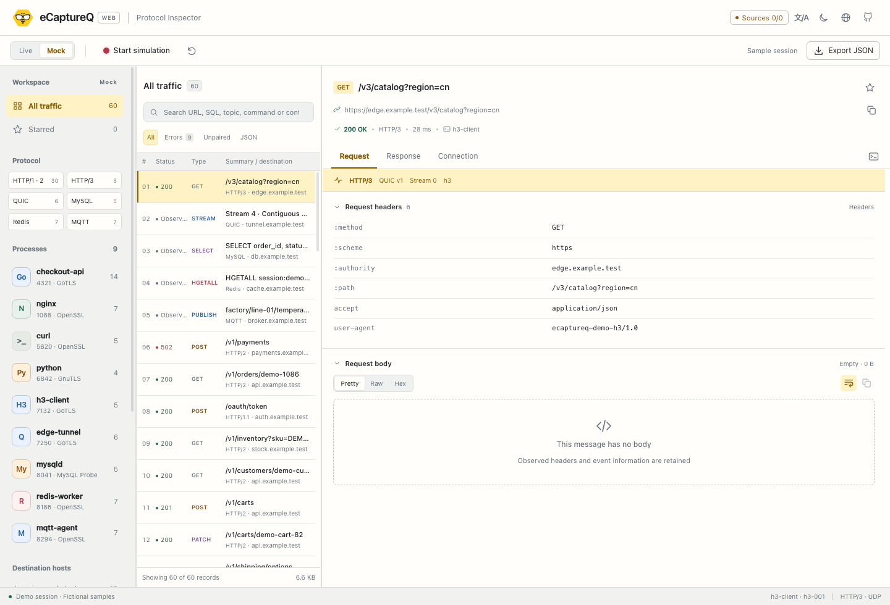
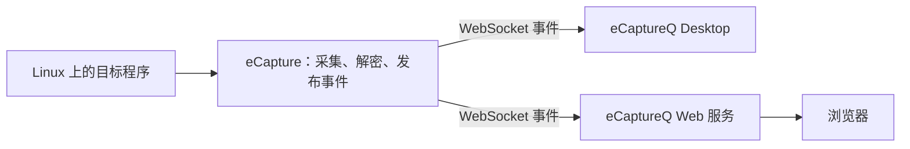
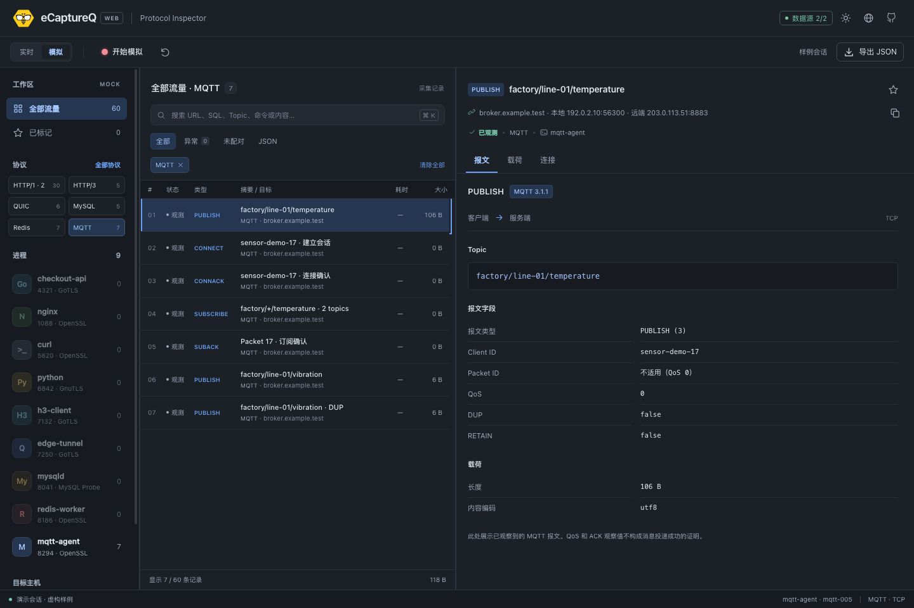
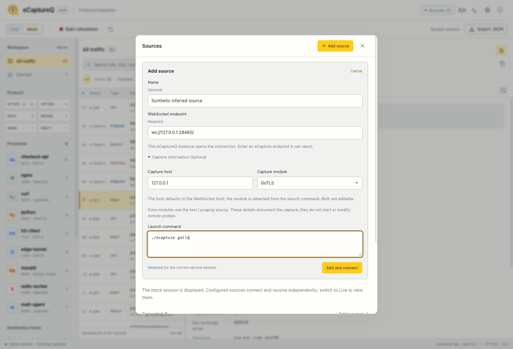

<p align="center">
  
</p>

# eCaptureQ

**把 eCapture 采集到的网络消息，变成可搜索、可关联、可查看的协议工作区。**

在 macOS、Windows 或 Linux 上打开桌面应用，也可以通过浏览器使用 Web 版。按进程、协议和目标主机找到流量，在同一个界面查看请求、响应、连接、进程命令和 TLS 信息。

[下载](https://github.com/gojue/ecaptureQ/releases) · [快速开始](#快速开始) · [连接 eCapture](#连接-ecapture) · [完整文档](docs/README.md) · [反馈问题](https://github.com/gojue/ecaptureQ/issues)



*实际运行的共享 Web 界面。本文截图使用内置模拟数据或合成事件，未展示真实捕获内容。*

## eCapture 与 eCaptureQ 的关系

[eCapture](https://github.com/gojue/ecapture) 是采集端，**eCaptureQ 是分析界面**。两者独立运行，通过 eCapture 的 `--ecaptureq` WebSocket 接口连接。

| 项目 | 负责什么 | 在哪里运行 |
| --- | --- | --- |
| eCapture | 探针、流量捕获、解密，并发布标准事件 | 本文使用 Linux 采集主机；其他采集平台以 eCapture 官方支持范围为准 |
| eCaptureQ Desktop | 连接数据源、关联消息、筛选和展示 | macOS、Windows、Linux；直接打开桌面应用 |
| eCaptureQ Web | 相同的分析功能，通过浏览器访问 | 在服务器或本机运行 `ecaptureq-server`，再打开浏览器 |



桌面版可以连接远端 Linux，不需要在本机安装或启动采集探针，也不需要另启 Web 服务。**macOS / Windows 桌面支持不代表 eCapture 探针能在这些系统上运行。** Web 和 Desktop 各自维护缓存，分别启动的实例不会共享会话。

## 能做什么

- **查看协议消息**：HTTP/1.x、HTTP/2、HTTP/3、QUIC、MySQL、Redis、MQTT；HTTP 请求在前、响应在后，其他协议有各自的详情视图。
- **缩小分析范围**：按进程、协议、主机、异常和标记筛选，再搜索 URL、SQL、Topic、命令或正文。
- **追溯连接与进程**：查看数据源、PID、进程启动命令，以及采集事件提供的 TLS 版本、SNI、ALPN、密码套件、JA3/JA4 等信息。
- **读懂消息内容**：格式化、原文、Hex、HTTP 正文解压和图片本地预览；图片使用捕获字节，不重新访问原地址。
- **管理多个来源**：独立连接与重连，查看各来源状态和日志；支持 JSON 导出、深浅主题和可拖动分栏。

真实协议能力取决于 eCapture、所选采集模式和事件内容。模拟数据中的协议样例不代表任意流量都能被采集或解析；缺失的进程、TLS 或另一侧消息会保留为未知。



*按 MQTT 筛选后查看 Topic、QoS、Packet ID 和载荷信息；图中数据为模拟样例。*

## 快速开始

### 1. 选择下载包

从 [Releases](https://github.com/gojue/ecaptureQ/releases) 选择文件名中带 `desktop` 或 `server` 的新版产物。如果尚未发布新版，可在成功的 [CI 运行](https://github.com/gojue/ecaptureQ/actions/workflows/ci.yml) 页面下载 `release-bundle` 预览包。

文件名格式为 `ecaptureq-<版本>-<类型>-<系统>-<架构>.<格式>`。`amd64` 也叫 x86_64 / x64，`arm64` 也叫 aarch64；Mac 的 Apple Silicon 选 ARM64，Intel 选 AMD64。

| 系统 | 桌面版 | Web 服务版 |
| --- | --- | --- |
| macOS | `desktop-darwin-amd64.dmg` / `desktop-darwin-arm64.dmg`，也提供 ZIP | `server-darwin-amd64.zip` / `server-darwin-arm64.zip` |
| Windows | `desktop-windows-amd64.zip` / `desktop-windows-arm64.zip` | `server-windows-amd64.zip` / `server-windows-arm64.zip` |
| Linux | `desktop-linux-amd64.tar.gz` / `desktop-linux-arm64.tar.gz` | `server-linux-amd64.tar.gz` / `server-linux-arm64.tar.gz` |

表中省略了共同的 `ecaptureq-<版本>-` 前缀。发布包附有 `SHA256SUMS`；签名状态见包内 `BUILD-INFO.json`。Android 和 iOS 暂无客户端产物，支持计划待定。

### 2. 打开桌面版，或启动 Web 版

**桌面版**

- **macOS**：打开 DMG，将 `eCaptureQ.app` 拖到 Applications 后启动；也可解压 ZIP 后打开应用。构建最低目标为 macOS 12，旧系统的实际兼容性见[验证记录](docs/verification.md)。
- **Windows**：解压 ZIP，运行 `eCaptureQ.exe`。若提示缺少 WebView2，安装微软的 [WebView2 Runtime](https://developer.microsoft.com/en-us/microsoft-edge/webview2/)。
- **Linux**：解压 tar.gz，在图形桌面会话中运行 `./eCaptureQ`。需要 GTK4 和 WebKitGTK 6.0；例如 Ubuntu 24.04 可先执行：

```sh
sudo apt-get install libgtk-4-1 libwebkitgtk-6.0-4
```

**Web 版**

解压对应系统的 `server` 包，在解压目录打开终端：

```sh
# macOS / Linux
./ecaptureq-server --addr 127.0.0.1:28257
```

```powershell
# Windows PowerShell
.\ecaptureq-server.exe --addr 127.0.0.1:28257
```

浏览器访问 **http://127.0.0.1:28257/**。Web 版不需要桌面 GUI 库；默认只监听回环地址。远程访问及反向代理子路径配置见[使用参考](docs/reference.md)。

### 3. 先用模拟数据熟悉界面

首次启动默认进入模拟模式，不需要 eCapture。左侧选择进程或协议，中间点击一条记录，右侧切换请求、响应和连接详情。点击「开始模拟」可持续追加演示记录；切换「实时」后查看已连接数据源收到的消息。

## 连接 eCapture

以下示例使用 **28256 作为采集端 WebSocket 端口**，**28257 作为 eCaptureQ Web 页面端口**。

### 1. 在 Linux 采集主机启动 eCapture

下载适用于该主机的 [eCapture](https://github.com/gojue/ecapture/releases)，使用支持 `--ecaptureq` 和 `--text-source pcapng` 的版本。以 OpenSSL/TLS 流量为例，在 eCapture 所在目录运行：

```sh
sudo ./ecapture tls -m text --text-source pcapng -i eth0 \
  --ecaptureq ws://127.0.0.1:28256/
```

将 `eth0` 换成实际流量经过的接口；本机 loopback 流量通常使用 `lo`。Go TLS 程序应选择 `gotls` 并指定 `--elfpath`，GnuTLS 应选择 `gnutls`，详见 [eCapture 使用说明](https://github.com/gojue/ecapture#readme)及[本项目协议参考](docs/reference.md)。需要完整进程命令和 TLS 详情时，请使用包含对应字段的新版采集器，见[兼容性说明](docs/upstream-status.md)。

`--ecaptureq` 让 **eCapture 开启事件监听端口**；eCaptureQ 连接它。不要用 `--eventaddr` 的原始输出地址代替这个接口。

### 2. 连接远端主机时建立 SSH 隧道

如果 eCaptureQ 和采集器不在同一台机器，在运行 eCaptureQ 的机器上执行并保持该会话：

```sh
ssh -N -L 127.0.0.1:28256:127.0.0.1:28256 user@linux-host
```

把 `user@linux-host` 换成实际 SSH 目标。这样可以保持采集端只监听回环地址；内置事件接口没有应用层认证，不建议直接暴露到公网。同机使用时可省略隧道。

### 3. 在 eCaptureQ 添加来源

1. 点击右上角的数据源状态，再点击「添加数据源」。
2. 输入名称和 `ws://127.0.0.1:28256/`，点击「添加并连接」。
3. 切换到「实时」，在目标程序中产生流量，查看记录与详情。

右上角显示「已连接数 / 总来源数」，面板中可查看每个来源的状态、重连和运行日志。可以重复添加多个数据源，单个来源断线不会停止其他来源。

**Web 模式的连接由 `ecaptureq-server` 发起，不是由浏览器发起。** 地址中的 `127.0.0.1` 指运行服务的机器，SSH 隧道也应建在那台机器上。桌面模式则由桌面应用所在机器连接。



*面板演示使用两个本地合成 Protobuf 来源；实际使用时替换为自己的 eCapture 地址。*

也可以启动时指定来源：

```sh
./ecaptureq-server --mode live --ecaptureq ws://127.0.0.1:28256/
```

需要在重启后保留来源配置时，将包内 `config/sources.example.json` 复制为自己的文件，修改端点后通过 `--sources sources.local.json` 启动。未指定配置文件时，在界面新增的来源只保留在当前实例中。桌面带参数启动、配置格式及错误处理见[使用参考](docs/reference.md)。

## 日常使用与常见问题

- **连接成功却没有记录？** 先切换到「实时」，清除筛选，再检查采集模块、目标程序、网卡及来源日志。连接成功只说明事件通道可用，不代表采集器已捕获到目标流量。
- **「未配对」是什么意思？** 当前记录尚未关联到另一侧消息；不等于请求仍在服务端执行。采集开始前、断线期间或已经被淘汰的消息无法补造。
- **暂停后是否停止采集？** 「暂停刷新」仅停止页面记录更新，后台仍继续接收。
- **记录能保存多久？** 默认保留最多 65,536 条记录、192 MiB 计量缓存，先达到任一上限就淘汰最旧记录。192 MiB 不是整个进程的内存上限；退出后实时缓存和日志会丢失，需要保留时及时导出 JSON。
- **星标会永久保存吗？** 星标只保留在当前页面会话，不阻止缓存淘汰；刷新页面或切换数据模式会清空。
- **旧版可以直接升级吗？** 新版采用全新实现，旧配置与会话不会自动导入；当前不提供 SQL 过滤或集成探针启动。请先阅读[升级说明](docs/upgrade.md)。

捕获内容可能含业务数据、令牌或个人信息。分享导出文件或问题截图前，请自行检查和脱敏。

## 更多文档

- [使用参考](docs/reference.md)：配置、CLI、子路径部署、协议能力和缓存行为。
- [编译指南](docs/compilation.md)：从源码构建 Web 与桌面版。
- [开发指南](docs/development.md)：代码结构、调试、测试和协议边界。
- [构建与发布](docs/releases.md)：版本标签、平台矩阵、签名和发布流程。
- [文档索引](docs/README.md) · [验证记录](docs/verification.md) · [提交问题](https://github.com/gojue/ecaptureQ/issues)。

许可证：[Apache-2.0](LICENSE)，版权与资源来源见 [NOTICE](NOTICE)。
